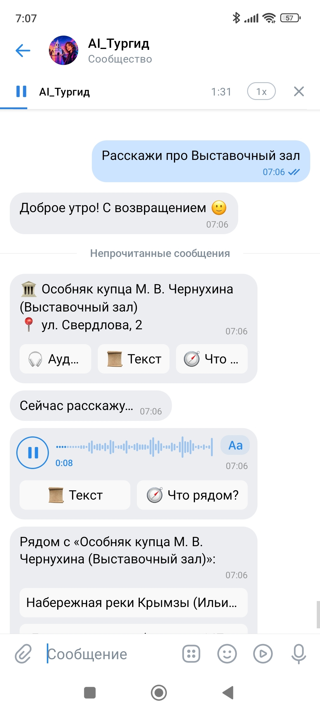
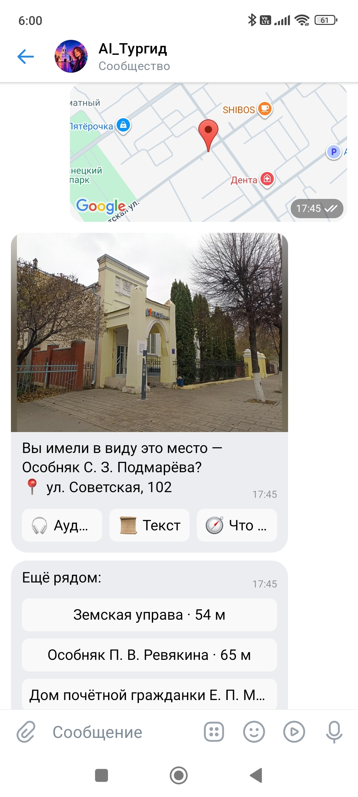
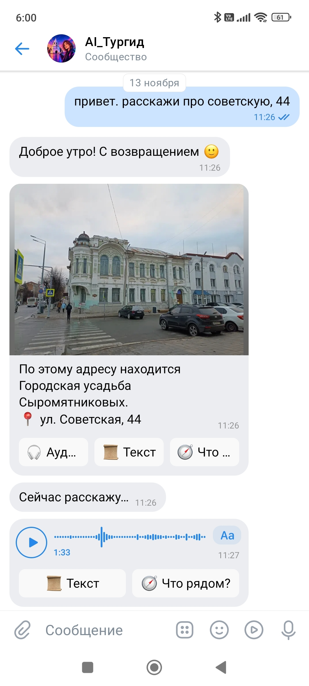
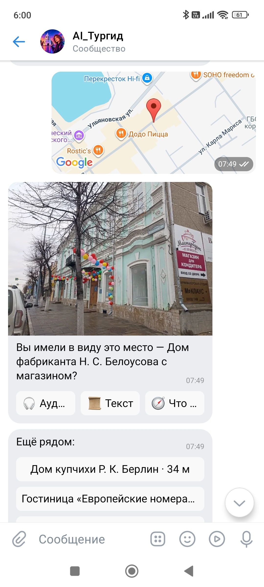
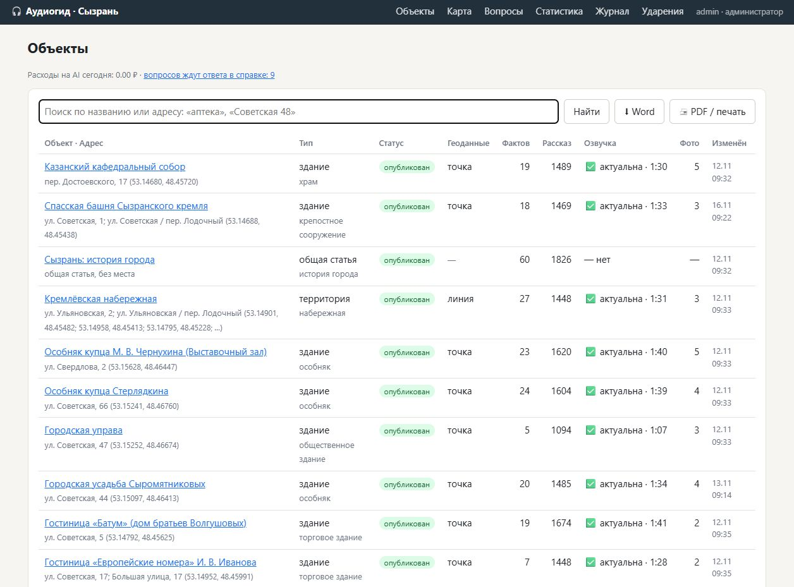
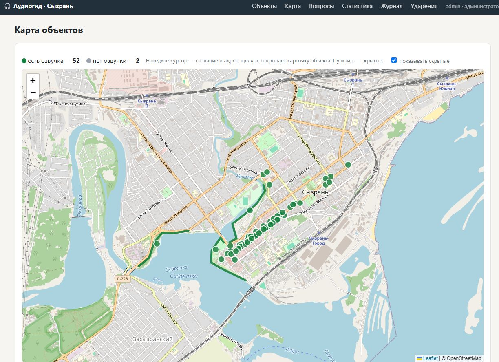
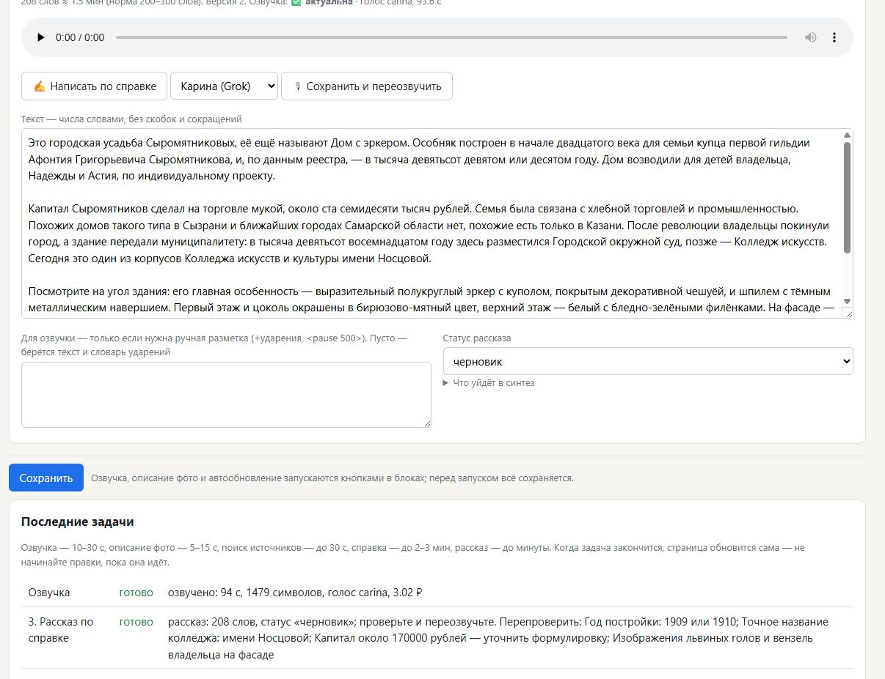
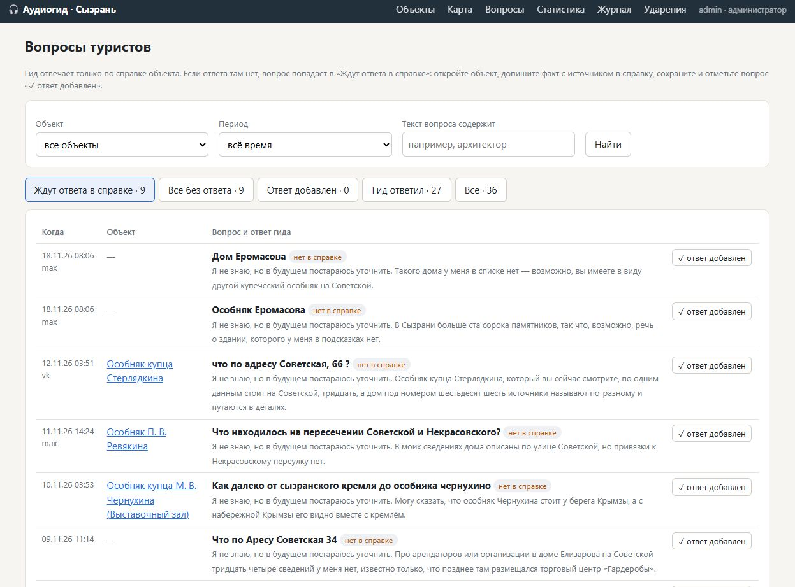

# AI-аудиогид по Сызрани

**Концепция голосового гида, который помогает туристам узнавать город через фотографии, геопозицию и вопросы.** Проект соединяет аудиоконтент о достопримечательностях, диалогового помощника и инструменты редакторской работы.

> Это презентация проекта и портфолио. Исходный код, внутренние скрипты, промпты и рабочие данные не публикуются.

## Задача

Сделать знакомство с городом простым и доступным прямо во время прогулки: туристу не нужно заранее искать информацию или устанавливать отдельное приложение. Он может обратиться к гиду привычным способом — отправить фото, указать место или задать вопрос.

## Как это работает

1. Турист отправляет фотографию, геопозицию, адрес или название места.
2. Гид определяет объект среди подготовленного каталога либо просит уточнить выбор.
3. Для объекта доступны заранее подготовленный аудиорассказ, текстовая версия и краткая информация.
4. Турист может задать уточняющий вопрос голосом или текстом.
5. Если в проверенной базе нет ответа, гид не должен додумывать факт: такой вопрос становится сигналом для редактора.

## Попробовать гида

- [ВКонтакте](https://vk.ru/ai_turgid)
- [MAX](https://max.ru/id632512249092_1_bot)
- [Telegram](https://t.me/ai_turgid_bot)

## Скриншоты

### Бот в мессенджерах

| Диалог | Диалог | Диалог | Диалог |
| --- | --- | --- | --- |
|  |  |  |  |

### Веб-админка

| Обзор объектов | Карточка объекта | Материалы и рассказы | Интерфейс редактора |
| --- | --- | --- | --- |
|  |  |  |  |

## Что реализовано

- Диалоговый гид с поддержкой нескольких каналов: MAX, ВКонтакте и Telegram.
- Поиск объектов по геопозиции, адресу, названию и фотографии.
- Заранее подготовленные рассказы, которые можно выдавать готовым аудио.
- Голосовые вопросы и ответы, а также текстовый сценарий.
- Карточки объектов с фотографиями и кнопками действий.
- Веб-админка для управления объектами, справочными материалами, рассказами и произношением.
- Учёт вопросов туристов и статистика использования для дальнейшего улучшения контента.
- Географическая модель данных для объектов разных типов, включая протяжённые пространства.

## Принципы продукта

- **Audio-first:** основное содержание предназначено для прослушивания; интерфейс остаётся простым.
- **Подготовленный контент:** рассказы проверяются и озвучиваются заранее.
- **Ответы на основе источников:** гид опирается на базу проекта и не должен придумывать недостающие факты.
- **Человек в контуре:** редактор проверяет материалы и дополняет базу по вопросам пользователей.
- **Модульная архитектура:** бизнес-логика отделена от мессенджеров и AI-провайдеров.
- **Безопасное обращение с геоданными:** геопозиция пользователя не предназначена для долговременного хранения.

## Архитектурный обзор

```text
MAX / ВКонтакте / Telegram
            │
            ▼
   Общая логика диалога
            │
      ┌─────┴─────┐
      ▼           ▼
 Каталог и БД   Адаптеры внешних сервисов
      │           │
      └─────┬─────┘
            ▼
  Готовые рассказы и ответы

Редактор ──► веб-админка ──► объекты, источники, рассказы, озвучка
```

Система спроектирована как модульный бэкенд: каналы общения используют общую логику, а внешние сервисы подключаются через отдельные адаптеры. Это позволяет развивать продукт без привязки сценариев к одному мессенджеру или поставщику технологий.

## Технологический профиль

- **Backend:** Python, FastAPI, асинхронная обработка.
- **Данные:** PostgreSQL с геопространственными возможностями; векторный поиск рассматривается для расширения базы знаний.
- **Каналы:** MAX, ВКонтакте, Telegram.
- **Голос:** распознавание речи и синтез аудио через сменяемые интеграции.
- **Администрирование:** веб-интерфейс редактора контента.

Перечень конкретных поставщиков и детали внутренней конфигурации намеренно не раскрываются в публичной презентации.

## Сценарии пользователя

### Узнать место по фотографии

Турист фотографирует здание. Гид ищет совпадение в каталоге и показывает карточку объекта. При недостаточной уверенности он может не делать категоричный вывод.

### Начать рассказ рядом с объектом

Геопозиция помогает найти ближайшие места. Турист выбирает объект и запускает рассказ.

### Задать вопрос

После рассказа можно спросить о деталях голосом или текстом. Ответ формируется на основе подготовленных справочных материалов.

### Улучшать базу через обратную связь

Вопросы, на которые не хватает информации, помогают редактору определить, какие справки нужно дополнить.

## Статус

Рабочий прототип с ботами в нескольких каналах и веб-админкой. Проект развивается итеративно: проверяются реальные пользовательские сценарии, качество распознавания, удобство диалога и полнота контента.

**Текущий фокус:** качество каталога и рассказов, предсказуемые ответы, удобство редакторской работы и подготовка основы для масштабирования на другие города и культурные площадки.

## Для кого может быть полезен

- туристско-информационным центрам и городским командам;
- музеям, библиотекам и культурным учреждениям;
- проектам, которым нужен голосовой гид без отдельного мобильного приложения.

## Планы развития

- Расширение базы объектов и тематических материалов.
- Развитие поиска по базе знаний и проверка качества ответов на наборе вопросов.
- Подготовка маршрутов и сценариев прогулки.
- Улучшение аналитики использования для редакторов и партнёров проекта.
- Возможность адаптации решения для другого города или музея.

## Границы публичной версии

Этот репозиторий предназначен для ознакомления с проектом и не является дистрибутивом приложения. В нём нет исходников, исполняемых скриптов, системных промптов, секретов, рабочих конфигураций или базы контента. Публичные материалы описывают назначение, пользовательские сценарии и архитектурный подход на обзорном уровне.

## Лицензия и использование

Все права на концепцию и материалы этой презентации сохраняются за автором. Публикация не предоставляет права копировать, распространять или использовать проект и его материалы в коммерческих целях без отдельного письменного разрешения.

---

*Презентационная версия проекта. Детали реализации и рабочий код не публикуются.*
